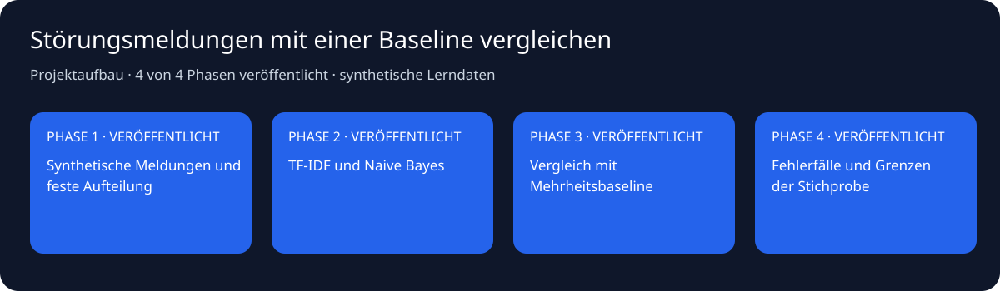

# Störungsmeldungen mit einer Baseline vergleichen

Ein kleiner Textklassifikator soll gegen eine nachvollziehbare Mehrheitsbaseline geprüft werden; Datentrennung und Grenzen der Beispiele müssen sichtbar bleiben.



**Veröffentlichungsstand: Phase 4/4.** Dieses eigenständige Repository übernimmt zunächst den bereits lokal committeten Stand. Weitere fachliche Phasen werden im Abstand von mindestens vier Stunden veröffentlicht. Die technische Entwicklung und die öffentliche Veröffentlichung haben unterschiedliche echte Zeitpunkte.

## Was hier zu sehen ist

| Schritt | Inhalt | Hier veröffentlicht |
|---|---|---|
| 1 | Synthetische Meldungen und feste Aufteilung | Ja |
| 2 | TF-IDF und Naive Bayes | Ja |
| 3 | Vergleich mit Mehrheitsbaseline | Ja |
| 4 | Fehlerfälle und Grenzen der Stichprobe | Ja |

## Fachlicher Nutzen

ML-Pipeline, Datentrennung, Konfusionsmatrix und kritische Interpretation von Kennzahlen.

## Lokal starten

Im geklonten Repository ausführen; die benötigte Laufzeit muss installiert sein. Python-Beispiele verwenden 3.12, Node-Beispiele 24 und C# die im Projekt angegebene .NET-Version. Befehle mit uv laden die dort genau bezeichneten Pakete bei Bedarf.

```powershell
uv run --with scikit-learn==1.9.1 --with pandas==3.1.0 --with numpy==2.5.4 python -X utf8 nachweise/P13-T04-pruefen.py
```

Ausführliche technische Befehle: [START.md](START.md). [Öffentlicher Prüfstand](ABNAHME.json) und [Quellphasen](VERLAUF.json) dokumentieren Herkunft und echte Ausführungsdaten. Eine neue Repositorykopie ist kein neuer nativer Desktoplauf.

## Ergebnis des lokal geprüften Schlussstands

60 Meldungen, 42/18-Aufteilung; Baseline 6/18, Modell 18/18. Nur sechs verschiedene Texte; alle Testtexte kommen schon im Training vor.

## Grenzen

Die hohe Trefferzahl belegt keine Generalisierung auf neue oder industrielle Meldungen.

Eigenes kleines Lernprojekt mit synthetischen Daten, mit KI-Unterstützung entwickelt und geprüft. Keine Aussage über Berufserfahrung, menschliche Arbeitsstunden oder praktische Verwendung weiterer nur geplanter Produkte.
